# Informe de Laboratorio — Guía 8

**Procesamiento Distribuido de Datos**

*Trabajo grupal · Sesión 14 · Semana 16*

| Campo | Dato |
|---|---|
| Asignatura / programa | *[Completar]* |
| Docente | *[Completar]* |
| Grupo | *[Completar]* |
| Integrantes | *[Completar con los nombres del equipo]* |
| Módulo | Gestión de Recursos y Tolerancia a fallos |
| Eje temático | Procesamiento Distribuido de Datos |
| Código de la guía | LA-PR-001-FM-003 (versión 7) |
| Sesión / Semana | 14 / 16 |
| Tipo de trabajo | Grupal |
| Fecha de ejecución | 17 de noviembre de 2026 |

---

## Resumen ejecutivo

Se diseñó, implementó y midió una solución de procesamiento distribuido para analizar hasta 500 000 ventas sintéticas de una empresa comercial con presencia en ocho ciudades de Colombia. La solución reparte los registros entre varios nodos simulados (procesos independientes de Python), cada nodo calcula agregados parciales y un consolidador integra los resultados. Se compararon dos estrategias de distribución: **A — envío de registros**, en la que el coordinador lee todo el archivo y envía las filas a cada nodo, y **B — localidad de datos**, en la que cada nodo lee directamente su propio bloque del archivo, como hacen HDFS y Apache Spark.

En todos los volúmenes y estrategias, el resultado distribuido fue **idéntico** al secuencial. La estrategia A fue siempre más lenta que el procesamiento secuencial (aceleración de 0,04× a 0,19×): el costo de enviar las filas representó el 96 % del tiempo. La estrategia B, en cambio, logró **1,94× con 4 nodos** sobre 500 000 registros y procesó 944 751 registros por segundo. La escalabilidad mostró rendimientos decrecientes (2,12× con 4 nodos y 2,13× con 8, frente a 6 núcleos físicos disponibles). Las mismas consultas se ejecutaron con **Apache Spark 3.5.3** con resultados idénticos: Spark es más lento con pocos datos por su costo fijo, pero con 2 millones de registros ya iguala al procesamiento secuencial. Por último, se provocaron **fallos reales** en un nodo: sin tolerancia a fallos se perdió el 25 % de los registros y los ingresos quedaron subestimados un 24,8 % sin que el sistema lo advirtiera; con detección y reintento de la partición, el resultado volvió a ser exacto.

**Índice de figuras**

- Figura 1. Arquitectura del procesamiento distribuido.
- Figura 2. Tiempo secuencial vs distribuido con las estrategias A y B.
- Figura 3. Escalabilidad de 1 a 8 nodos.
- Figura 4. Escenario CPU-intensivo.
- Figura 5. Tolerancia a fallos: mecanismo y resultado medido.
- Figura 6. Reporte consolidado de ventas.
- Figura 7. Resultados parciales por nodo frente a la consolidación.
- Figura 8. Python secuencial vs Python distribuido vs Apache Spark.
- Figuras 9 a 12. Evidencias de la interfaz gráfica.

---

## 1. Introducción

El volumen de información que generan las organizaciones crece más rápido que la capacidad de un solo computador. Cuando todo el análisis se hace en un único equipo, el tiempo de respuesta aumenta al ritmo de los datos y la memoria y la CPU se convierten en cuellos de botella. El **procesamiento distribuido de datos** responde a ese problema: divide el trabajo en unidades más pequeñas, las ejecuta en varios nodos y combina los resultados parciales en una salida única.

Esta guía parte de un caso empresarial. Una compañía registra miles de ventas diarias en distintas ciudades de Colombia y necesita conocer los productos más vendidos, los ingresos por ciudad y los meses de mayor actividad comercial. Hoy procesa todo en un solo equipo, y quiere saber si una solución distribuida le permitiría crecer.

Para responder se construyó una **simulación** de procesamiento distribuido en Python, se midieron sus tiempos frente al procesamiento secuencial con tres volúmenes de datos, se analizó la escalabilidad variando el número de nodos y se provocaron fallos para estudiar la tolerancia a fallos. Como complemento, las mismas consultas se resolvieron con Apache Spark (PySpark), la herramienta de referencia que menciona la guía, incluyendo una prueba con 2 millones de registros.

> **Nota de alcance:** no se dispuso de un clúster físico. Los "nodos" son procesos independientes del mismo equipo, creados con el módulo `multiprocessing`. Se trata de una **simulación y no de un clúster distribuido real**: no hay una red entre máquinas, pero sí particionamiento, ejecución concurrente, comunicación entre procesos (serialización), consolidación y fallos de procesos.

---

## 2. Objetivos

**Resultado de aprendizaje del módulo:** desarrollar, analizar y probar funcionalidades distribuidas aplicando principios avanzados de ingeniería de software para la construcción de sistemas complejos y escalables.

**Objetivo general:** diseñar, implementar y evaluar una solución de procesamiento distribuido que calcule indicadores de ventas y compararla con el procesamiento en un único equipo en términos de rendimiento, escalabilidad y tolerancia a fallos.

**Objetivos específicos:**

1. Generar conjuntos de datos sintéticos de ventas de 10 000, 100 000 y 500 000 registros con los campos que exige la guía.
2. Diseñar una arquitectura con fuente de datos, particionamiento, nodos de procesamiento, consolidación, reportes y registro de pruebas.
3. Implementar los ingresos por ciudad, el top 5 de productos por cantidad y los ingresos por mes, y comparar los resultados parciales con la consolidación final.
4. Medir el tiempo secuencial y distribuido con dos estrategias de distribución y calcular la aceleración y la eficiencia.
5. Simular el fallo de un nodo y evaluar mecanismos de detección, reintento y verificación.
6. Comparar la solución con una herramienta de la industria (Apache Spark).

---

## 3. Marco conceptual

### 3.1 Conceptos principales

- **Particionamiento de datos:** división de un conjunto de información en segmentos que pueden procesarse por separado.
- **Procesamiento paralelo:** ejecución simultánea de varias operaciones para reducir el tiempo total cuando la tarea lo permite.
- **Escalabilidad:** capacidad de incorporar más recursos para atender mayores volúmenes de información.
- **Tolerancia a fallos:** capacidad de continuar o recuperarse cuando falla un componente.
- **Consolidación de resultados:** integración de los resultados parciales de los nodos en una salida única.
- **Localidad de datos:** principio de "mover el cómputo hacia los datos": cada nodo procesa la porción de información que ya tiene disponible, en lugar de recibirla por la red.
- **Map / Reduce:** modelo en el que cada nodo aplica una función a su partición (*map*) y luego los resultados se combinan (*reduce*) (Dean y Ghemawat, 2008).

### 3.2 Métricas

\[
\text{Aceleración} = S = \frac{T_s}{T_p} \qquad
\text{Eficiencia} = E = \frac{S}{N}
\]

`T_s` es el tiempo secuencial, `T_p` el tiempo paralelo o distribuido y `N` el número de nodos. Si `S > 1`, la versión distribuida fue más rápida; `E` indica qué fracción del potencial de cada nodo se aprovechó (1 = ideal). Además se usó el *throughput* (registros procesados por segundo) y la ley de Amdahl, que limita la aceleración cuando una fracción `1 − p` del trabajo no puede paralelizarse:

\[
S_{max}(N) = \frac{1}{(1-p) + p/N}
\]

### 3.3 Respuestas a las preguntas orientadoras

**1. ¿Qué diferencias existen entre el procesamiento centralizado, paralelo y distribuido?**

| Modelo | Unidades de ejecución | Memoria | Comunicación | Ventaja principal | Limitación principal |
|---|---|---|---|---|---|
| Centralizado | Un solo equipo o proceso | Local | No requiere | Simplicidad, sin costo de coordinación | Límite de escala; punto único de fallo |
| Paralelo | Varios núcleos de un mismo equipo | Compartida (habitualmente) | Memoria o bus | Reduce el tiempo de cómputo | Limitado al hardware de una máquina |
| Distribuido | Varios nodos independientes en red | Propia de cada nodo | Mensajes por red | Escala horizontalmente y tolera fallos | Costos de comunicación, coordinación y consistencia |

Esta práctica se ubica entre los dos últimos: los procesos se ejecutan en paralelo en un equipo, pero no comparten memoria y se comunican por mensajes, igual que los nodos de un sistema distribuido.

**2. ¿Cómo contribuye la división de datos en particiones a mejorar el rendimiento?**

Al dividir los datos, cada partición puede procesarse al mismo tiempo; si las particiones son equilibradas y las operaciones son agregables (sumas y conteos), el tiempo de cómputo tiende a `T_s / N`. El experimento mostró que la *forma* de particionar es tan importante como el número de particiones: repartir filas ya leídas (estrategia A) obliga a copiarlas a cada proceso y anula la ganancia, mientras que asignar bloques del archivo para que cada nodo los lea (estrategia B) reparte también la lectura y el análisis, que son la parte más costosa, y produjo una aceleración real.

**3. ¿Qué funciones cumplen herramientas como Apache Spark y Hadoop en el procesamiento distribuido?**

**Hadoop** aporta almacenamiento distribuido y tolerante a fallos (HDFS, que divide los archivos en bloques y los replica en varios nodos), un gestor de recursos del clúster (YARN) y el modelo de procesamiento por lotes MapReduce (Apache Software Foundation, 2024a). **Spark** es un motor de análisis que ejecuta las operaciones como un grafo de tareas (DAG), mantiene los datos en memoria entre etapas y ofrece DataFrames y SQL; recupera las particiones perdidas recalculándolas a partir de su linaje (Zaharia et al., 2016). Ambas automatizan lo que en este laboratorio se programó a mano: partir los datos, enviar tareas, detectar fallos, reintentar y consolidar.

**4. ¿Qué problemas pueden presentarse cuando uno de los nodos falla durante el procesamiento?**

Se pierde el resultado parcial de ese nodo y el consolidado queda incompleto. El experimento de la Sección 9 lo comprobó: al caer uno de cuatro nodos se perdió el 25 % de los registros y los ingresos se subestimaron un 24,8 %, **sin ningún aviso**, porque el top 5 de productos siguió siendo el mismo y el resultado parecía razonable. También aparecen esperas cuando el nodo se bloquea en lugar de caer, y riesgo de duplicar datos si se reprocesa sin control.

**5. ¿Cómo se pueden evaluar el rendimiento, la escalabilidad y la confiabilidad de una solución distribuida?**

- **Rendimiento:** tiempo de ejecución (mediana de varias repeticiones), *throughput* y aceleración `S`.
- **Escalabilidad:** variar el volumen de datos y el número de nodos; observar la eficiencia `E` y compararla con la ley de Amdahl.
- **Confiabilidad:** verificar que el resultado distribuido sea igual al secuencial, inyectar fallos controlados y comprobar que el sistema los detecta, se recupera y entrega el resultado correcto.

---

## 4. Descripción del problema

Una empresa comercial registra miles de ventas diarias en ocho ciudades de Colombia. Su equipo de análisis necesita:

- calcular el **total de ingresos por ciudad**;
- identificar los **cinco productos con mayores ventas por cantidad**;
- calcular los **ingresos totales por mes** y determinar los meses de mayor actividad comercial;
- comparar los resultados obtenidos en las particiones con la consolidación final.

Hoy el procesamiento se realiza en un único equipo, y el tiempo de respuesta crece con el volumen. Se requiere evaluar si dividir el trabajo entre varios nodos reduce ese tiempo **sin alterar los resultados** y qué ocurre cuando un nodo falla.

**Requerimientos definidos por el equipo:**

| Tipo | Requerimiento |
|---|---|
| Funcional | Calcular las tres agregaciones de la Fase 3 sobre archivos CSV |
| Funcional | Permitir configurar el número de nodos y el volumen de datos |
| Calidad | El resultado distribuido debe ser igual al secuencial (verificación automática) |
| Rendimiento | Medir tiempos con al menos tres volúmenes y repetir cada medición |
| Confiabilidad | Detectar la caída o el bloqueo de un nodo y recuperar su partición |
| Ética | Usar solo datos sintéticos, sin información personal |

---

## 5. Fase 1 — Preparación de los datos

Los datos se generaron con `generar_datos.py`. Son **sintéticos**, no contienen información personal y usan una semilla fija (`42`), de modo que cualquier integrante obtiene exactamente los mismos archivos.

**Campos del conjunto de datos:**

| Campo exigido | Columna | Descripción | Tipo |
|---|---|---|---|
| ID de venta | `id_venta` | Identificador único (V-0000001, V-0000002…) | texto |
| Fecha | `fecha` | Día de la venta, formato `AAAA-MM-DD`, año 2025 | fecha |
| Ciudad | `ciudad` | Una de 8 ciudades colombianas | texto |
| Producto | `producto` | Uno de 10 productos de tecnología | texto |
| Cantidad | `cantidad` | Unidades vendidas (1 a 10) | entero |
| Precio unitario | `precio_unitario` | Valor por unidad en COP (precio base ±10 %) | decimal |

**Primeros registros reales de `datos/ventas_10k.csv`:**

```csv
id_venta,fecha,ciudad,producto,cantidad,precio_unitario
V-0000001,2025-09-01,Medellín,Audífonos,1,148465.21
V-0000002,2025-10-29,Medellín,Tablet,3,1223581.32
V-0000003,2025-04-17,Cúcuta,Smartphone,3,2190728.24
V-0000004,2025-04-19,Cali,Teclado,6,93606.77
V-0000005,2025-10-11,Medellín,Teclado,1,93690.20
```

**Conjuntos producidos:**

| Archivo | Registros | Tamaño | Uso |
|---|---:|---:|---|
| `datos/ventas_10k.csv` | 10 000 | 0,5 MB | Prueba pequeña |
| `datos/ventas_100k.csv` | 100 000 | 5,2 MB | Prueba intermedia, escenario intensivo y fallos |
| `datos/ventas_500k.csv` | 500 000 | 26,1 MB | Prueba de escala |
| `datos/ventas_2m.csv` (opcional) | 2 000 000 | 104 MB | Comparación con Spark (`--grande`) |

Para que el análisis sea interpretable, el generador aplica pesos realistas: los productos de bajo costo (mouse, audífonos, teclado) se venden en más unidades y noviembre y diciembre concentran más actividad por la temporada navideña.

---

## 6. Fase 2 — Diseño de la arquitectura distribuida

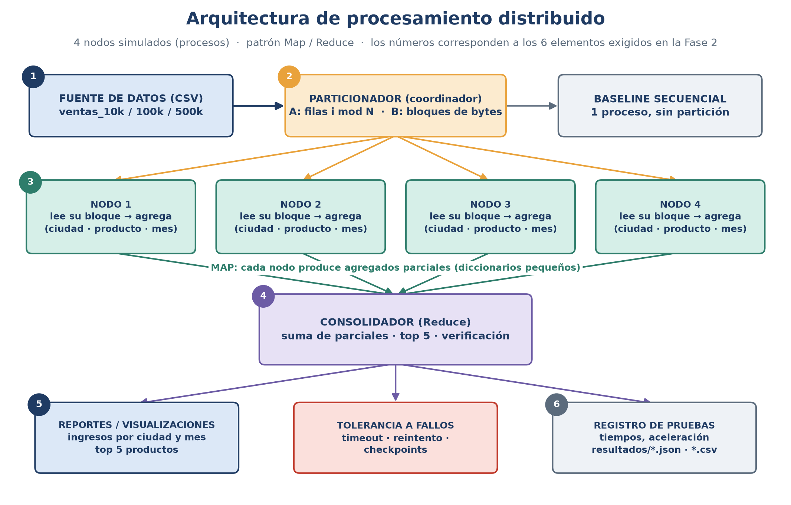

*Figura 1. Arquitectura del procesamiento distribuido. Los números marcan los seis elementos exigidos por la guía. Fuente: elaboración propia.*

**Elementos requeridos por la guía y cómo se implementan:**

| # | Elemento exigido | Implementación |
|---|---|---|
| 1 | Fuente de datos CSV | `datos/ventas_*.csv` generados en la Fase 1 |
| 2 | Mecanismo de distribución | Coordinador con dos estrategias: A (filas `i mod N`) y B (bloques de bytes alineados a fin de línea) |
| 3 | Dos o más nodos | 1 a 8 procesos de `multiprocessing.Pool`; por defecto 4 |
| 4 | Consolidación | Función `consolidar()`: suma los diccionarios parciales, calcula el top 5 y verifica contra el secuencial |
| 5 | Reportes y visualizaciones | `resultados_consolidados.json`, Figura 6 e interfaz gráfica |
| 6 | Registro de tiempos y resultados | `resultados/tabla_tiempos.csv`, `escalabilidad_nodos.csv`, `tolerancia_fallos.json`, `entorno.json` |

**Flujo de procesamiento (estrategia B):**

1. El coordinador mide el archivo y calcula N límites de bytes, ajustando cada uno al siguiente salto de línea para que ningún registro quede partido (equivale a los *splits* de HDFS).
2. Cada nodo recibe solo tres valores —ruta, byte inicial y byte final—, lee su bloque, convierte las líneas en registros y calcula ingresos por ciudad, unidades por producto e ingresos por mes (**map**).
3. Cada nodo devuelve un diccionario pequeño (8 ciudades, 10 productos, 12 meses), no las filas.
4. El consolidador suma los parciales y obtiene el top 5 (**reduce**). Como las tres operaciones son sumas —conmutativas y asociativas—, el orden en que llegan los parciales no cambia el resultado.
5. El resultado se compara con la ejecución secuencial y se registran los tiempos.

En la estrategia A el paso 1 es distinto: el coordinador lee todo el archivo y envía a cada nodo una lista con la cuarta parte de las filas. Es el diseño intuitivo, y se incluyó para medir cuánto cuesta mover los datos.

> El diagrama en formato Mermaid, editable, se conserva en el **Anexo B**.

---

## 7. Fase 3 — Implementación del procesamiento

### 7.1 Estructura del código

| Archivo | Responsabilidad |
|---|---|
| `generar_datos.py` | Fase 1: genera los tres CSV sintéticos |
| `procesamiento_distribuido.py` | Fases 3 y 4: particionamiento A y B, nodos, consolidación, verificación y mediciones |
| `tolerancia_fallos.py` | Fase 5: inyección de fallos, detección, checkpoints y reintento |
| `experimento_intensivo.py` | Experimento complementario con carga de CPU alta |
| `procesamiento_spark.py` | Las mismas consultas con Apache Spark (PySpark) |
| `generar_diagramas.py` | Las figuras del informe, leídas de `resultados/` |
| `interfaz_grafica.py` | Interfaz gráfica para ejecutar y visualizar todo el laboratorio |

Todo el código está comentado en español y usa solo la biblioteca estándar de Python, salvo las figuras (matplotlib) y la versión en Spark (pyspark).

### 7.2 Funciones clave

```python
def procesar_particion(filas):
    """MAP: se ejecuta en CADA NODO sobre su partición."""
    ingresos_ciudad = defaultdict(float)
    unidades_producto = defaultdict(int)
    ingresos_mes = defaultdict(float)
    for _id, fecha, ciudad, producto, cantidad, precio in filas:
        ingreso = cantidad * precio
        ingresos_ciudad[ciudad] += ingreso
        unidades_producto[producto] += cantidad
        ingresos_mes[fecha[:7]] += ingreso        # AAAA-MM
    return {...}                                   # agregados parciales


def calcular_bloques(ruta, numero_nodos):
    """Estrategia B: N bloques de bytes alineados a fin de línea."""
    ...
    for k in range(1, numero_nodos):
        archivo.seek(int(inicio_datos + k * paso))
        archivo.readline()            # avanza hasta el siguiente registro
        limites.append(archivo.tell())


def procesar_bloque(tarea):
    """Cada nodo lee SU bloque del archivo (localidad de datos)."""
    ruta, inicio, fin = tarea
    with open(ruta, "rb") as archivo:
        archivo.seek(inicio)
        datos = archivo.read(fin - inicio)
    return procesar_particion(analizar_texto(datos.decode("utf-8")))


def ejecutar_distribuido_bloques(ruta, numero_nodos):
    tareas = calcular_bloques(ruta, numero_nodos)
    with mp.Pool(processes=numero_nodos) as pool:
        parciales = pool.map(procesar_bloque, tareas)   # nodos en paralelo
    return consolidar(parciales)                         # REDUCE
```

La función `verificar()` compara el resultado distribuido con el secuencial: el número de registros, las unidades por producto y el top 5 deben ser exactamente iguales, y los ingresos (números de punto flotante, que pueden variar en el último decimal al sumarse en otro orden) deben coincidir con una tolerancia de un centavo.

### 7.3 Comparación entre las particiones y la consolidación final

La guía pide comparar los resultados de las particiones con la consolidación. La tabla muestra lo que entregó cada nodo al procesar 500 000 registros con la estrategia B:

| Nodo | Bytes leídos | Registros | Ingresos (COP) | Unidades | Tiempo (s) |
|---|---:|---:|---:|---:|---:|
| 1 | 6 516 620 | 125 012 | 258 823 470 518,53 | 402 873 | 0,379 |
| 2 | 6 516 556 | 124 973 | 256 157 204 513,51 | 401 820 | 0,363 |
| 3 | 6 516 564 | 125 004 | 257 275 289 295,19 | 401 490 | 0,357 |
| 4 | 6 516 554 | 125 011 | 259 938 476 388,02 | 401 957 | 0,383 |
| **Suma de parciales** | 26 066 294 | **500 000** | **1 032 194 440 715,25** | **1 608 140** | — |
| **Consolidado final** | — | **500 000** | **1 032 194 440 715,25** | **1 608 140** | — |
| **Secuencial** | — | 500 000 | 1 032 194 440 715,25 | 1 608 140 | — |

Los bloques quedaron equilibrados (diferencia máxima de 39 registros entre nodos) y la suma de los parciales coincide exactamente con el consolidado y con el procesamiento secuencial. El detalle por ciudad de cada nodo está en `resultados/particiones.json`.

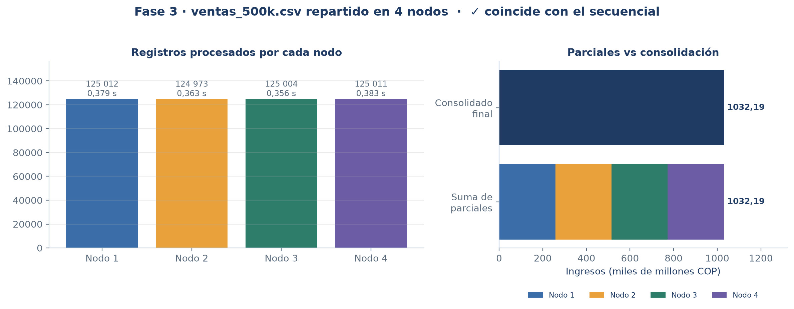

*Figura 7. Registros por nodo y suma de parciales frente al consolidado final. Fuente: elaboración propia con datos de `resultados/particiones.json`.*

### 7.4 Resultados del análisis de ventas (500 000 registros)

- Ingresos totales: **COP 1 032 194 440 715,25** (≈ 1,03 billones).
- Unidades vendidas: **1 608 140**.

**Top 5 de productos por unidades vendidas:**

| # | Producto | Unidades |
|---:|---|---:|
| 1 | Mouse | 288 614 |
| 2 | Audífonos | 257 504 |
| 3 | Teclado | 230 875 |
| 4 | DiscoDuro | 173 076 |
| 5 | Smartphone | 143 226 |

**Ingresos por ciudad (COP):**

| Ciudad | Ingresos | Participación |
|---|---:|---:|
| Pereira | 130 554 795 392,26 | 12,65 % |
| Cúcuta | 130 501 031 110,65 | 12,64 % |
| Bucaramanga | 130 242 796 495,47 | 12,62 % |
| Medellín | 129 451 395 028,84 | 12,54 % |
| Cali | 128 602 342 014,11 | 12,46 % |
| Cartagena | 128 141 282 704,62 | 12,41 % |
| Bogotá | 127 721 758 569,76 | 12,37 % |
| Barranquilla | 126 979 039 399,54 | 12,30 % |

**Ingresos por mes (COP):**

| Mes | Ingresos | Mes | Ingresos |
|---|---:|---|---:|
| 2025-01 | 65 399 300 543,16 | 2025-07 | 72 101 954 404,59 |
| 2025-02 | 56 434 236 291,67 | 2025-08 | 78 353 823 867,94 |
| 2025-03 | 72 245 172 509,63 | 2025-09 | 88 214 414 476,61 |
| 2025-04 | 72 124 678 213,42 | 2025-10 | 95 602 066 731,71 |
| 2025-05 | 81 250 394 868,79 | **2025-11** | **127 237 063 004,90** |
| 2025-06 | 79 014 650 227,51 | **2025-12** | **144 216 685 575,32** |

Los meses de mayor actividad comercial son **diciembre** y **noviembre**, que juntos suman el 26,3 % de los ingresos del año; el más bajo es febrero. Como las ventas se asignan a las ciudades de manera uniforme en los datos sintéticos, los ingresos por ciudad son parecidos (diferencia máxima del 2,8 %).

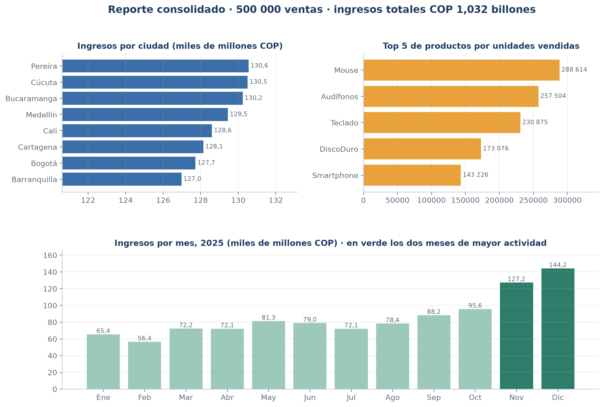

*Figura 6. Reporte generado a partir de la consolidación: ingresos por ciudad, top 5 de productos e ingresos por mes. Fuente: elaboración propia con datos de `resultados/resultados_consolidados.json`.*

---

## 8. Fase 4 — Pruebas de rendimiento

### 8.1 Entorno y condiciones de prueba

| Parámetro | Valor |
|---|---|
| Fecha | 17 de noviembre de 2026 |
| Equipo | Portátil, procesador Intel de 11.ª generación (familia 6, modelo 141) |
| Núcleos | 6 físicos / 12 lógicos |
| Sistema operativo | Windows 11 (compilación 26200) |
| Python | 3.12.10 |
| Nodos simulados | 4 (1, 2, 4 y 8 en la prueba de escalabilidad) |
| Repeticiones | 5 por medición; se reporta la **mediana** |
| Reloj | `time.perf_counter()` |
| Semilla de los datos | 42 |

Para mantener condiciones comparables, todas las pruebas se ejecutaron en el mismo equipo y en la misma sesión, y cada medición se repitió cinco veces para reducir el efecto de los procesos en segundo plano (antivirus, actualizaciones). El laboratorio completo se ejecutó tres veces y las aceleraciones fueron consistentes (por ejemplo, la estrategia B con 500 000 registros dio entre 1,94× y 2,41×); este informe reporta la última corrida. Los tiempos distribuidos **incluyen** la creación de los procesos, el envío de tareas y la consolidación. Se hicieron dos comparaciones justas: la estrategia A contra un secuencial que también parte de los datos ya cargados en memoria (solo cálculo), y la estrategia B contra un secuencial que también lee el archivo (lectura + cálculo).

### 8.2 Resultados: secuencial vs distribuido (4 nodos)

**Estrategia A — envío de registros (solo cálculo):**

| Registros | T secuencial (s) | T distribuido (s) | Aceleración S | Eficiencia E | Coordinación (s) | Resultados iguales |
|---:|---:|---:|---:|---:|---:|:---:|
| 10 000 | 0,0083 | 0,1919 | 0,04× | 0,011 | 0,1870 | Sí |
| 100 000 | 0,0469 | 0,2977 | 0,16× | 0,039 | 0,2919 | Sí |
| 500 000 | 0,1935 | 1,0386 | 0,19× | 0,047 | 0,9968 | Sí |

**Estrategia B — localidad de datos (lectura + cálculo):**

| Registros | T secuencial (s) | T distribuido (s) | Aceleración S | Eficiencia E | Registros/s (B) | Resultados iguales |
|---:|---:|---:|---:|---:|---:|:---:|
| 10 000 | 0,0193 | 0,2454 | 0,08× | 0,020 | 40 749 | Sí |
| 100 000 | 0,2850 | 0,2344 | **1,22×** | 0,304 | 426 611 | Sí |
| 500 000 | 1,0271 | 0,5292 | **1,94×** | 0,485 | 944 751 | Sí |

> El "costo de coordinación" es el tiempo distribuido menos el tiempo de trabajo útil del nodo más lento; incluye arrancar los procesos, enviar datos y consolidar. La desviación estándar de cada medición se guarda en `resultados/tabla_tiempos.csv`.

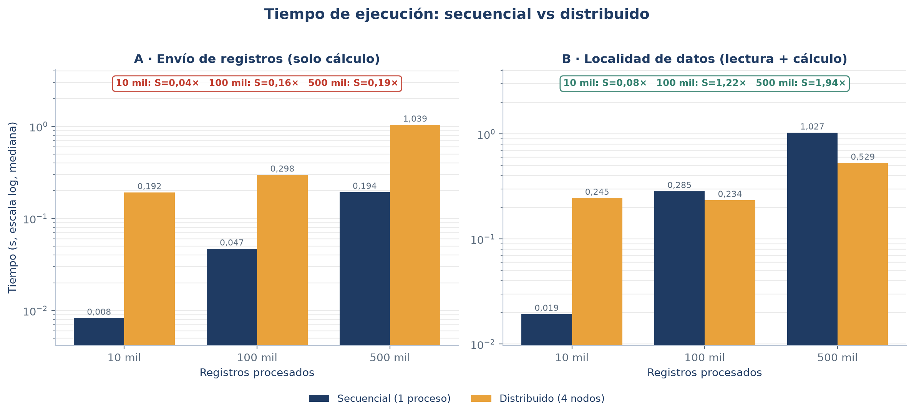

*Figura 2. Tiempo de ejecución por volumen de datos con las dos estrategias (escala logarítmica). Fuente: elaboración propia con datos de `resultados/tabla_tiempos.csv`.*

### 8.3 Escalabilidad según el número de nodos (500 000 registros)

| Nodos | T A (s) | S A | T B (s) | S B vs secuencial | S relativa B = T(1)/T(N) | Eficiencia relativa B |
|---:|---:|---:|---:|---:|---:|---:|
| 1 | 1,3191 | 0,17× | 1,0540 | 0,98× | 1,00× | 1,00 |
| 2 | 1,1577 | 0,19× | 0,6642 | 1,56× | 1,59× | 0,79 |
| 4 | 1,0469 | 0,21× | 0,4970 | 2,09× | 2,12× | 0,53 |
| 8 | 1,0454 | 0,21× | 0,4943 | 2,10× | 2,13× | 0,27 |

Con un solo nodo, la estrategia B tarda prácticamente lo mismo que el secuencial (0,98×), lo cual confirma que la comparación es justa: la ganancia posterior proviene del paralelismo y no de una ventaja oculta del código.

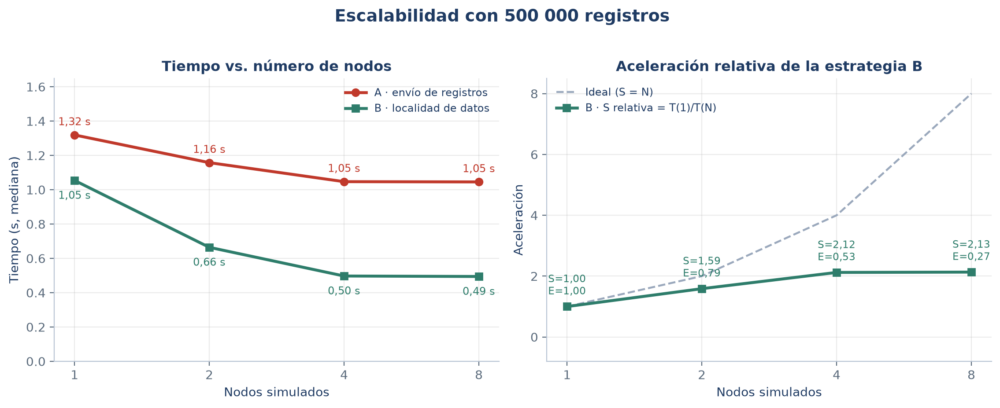

*Figura 3. Tiempo de ambas estrategias y aceleración relativa de la estrategia B frente al caso ideal. Fuente: elaboración propia con datos de `resultados/escalabilidad_nodos.csv`.*

### 8.4 Experimento complementario: carga intensiva de CPU

Para aislar el efecto del tipo de carga se repitió la estrategia A con 100 000 registros, añadiendo a cada registro 120 iteraciones de operaciones trigonométricas (un "índice de riesgo" ficticio). Así, cada registro exige mucho más cómputo y el costo de enviarlo pesa relativamente menos.

| T secuencial (s) | T distribuido (s) | Aceleración S | Eficiencia E | Coordinación (s) | Resultados iguales |
|---:|---:|---:|---:|---:|:---:|
| 2,8972 | 1,1994 | **2,42×** | 0,604 | 0,2830 | Sí (diferencia relativa 0,0) |

La misma estrategia A que era 5 veces más lenta en la agregación simple resulta 2,4 veces más rápida cuando el trabajo por registro es alto.

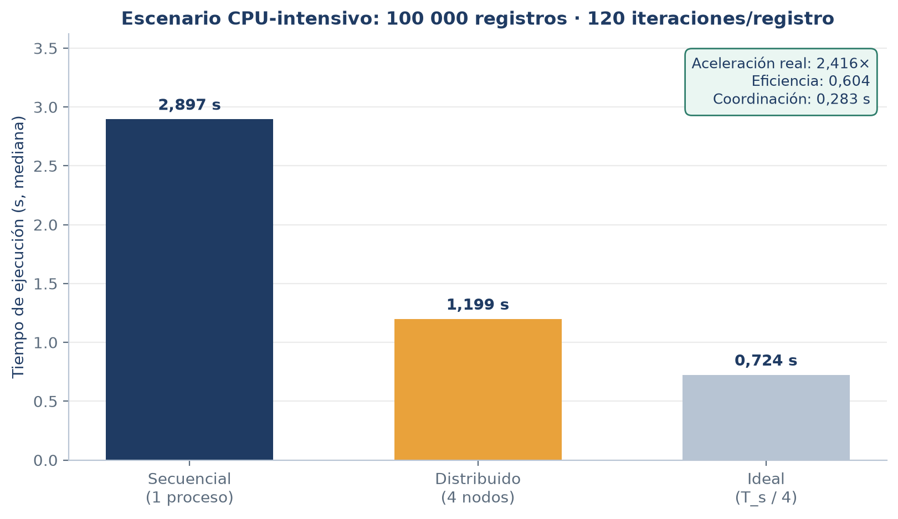

*Figura 4. Escenario CPU-intensivo frente al caso ideal de cuatro nodos. Fuente: elaboración propia con datos de `resultados/escenario_intensivo.json`.*

### 8.5 Comparación con Apache Spark

`procesamiento_spark.py` resuelve las mismas tres consultas con DataFrames de Apache Spark en modo `local[4]` (un equipo con cuatro hilos ejecutores; en un clúster solo cambiaría el parámetro `master`). El código esencial es:

```python
ventas = (spark.read.csv(ruta, header=True, schema=esquema)
          .repartition(4)
          .withColumn("ingreso", F.col("cantidad") * F.col("precio_unitario"))
          .withColumn("mes", F.substring("fecha", 1, 7)))
ventas.groupBy("ciudad").agg(F.sum("ingreso"))      # por ciudad
ventas.groupBy("producto").agg(F.sum("cantidad").alias("u")) \
      .orderBy(F.desc("u")).limit(5)                # top 5
ventas.groupBy("mes").agg(F.sum("ingreso"))         # por mes
```

Para ver qué pasa con millones de registros se generó además un conjunto de **2 000 000 de ventas** (`python generar_datos.py --grande`, 104 MB). En la misma corrida se midieron el Python secuencial, la estrategia B con 4 procesos y Spark con 4 hilos (mediana de 3 repeticiones, después de una ejecución de calentamiento):

| Registros | Python secuencial (s) | Python B, 4 procesos (s) | Spark local[4] (s) | S de Spark vs secuencial | Resultados iguales |
|---:|---:|---:|---:|---:|:---:|
| 10 000 | 0,021 | 0,256 | 1,173 | 0,02× | Sí |
| 100 000 | 0,228 | 0,296 | 1,201 | 0,19× | Sí |
| 500 000 | 1,267 | 0,718 | 1,839 | 0,69× | Sí |
| 2 000 000 | 5,344 | 1,940 | 5,240 | 1,02× | Sí |

Además, crear la sesión de Spark (arrancar la máquina virtual de Java) tomó 6,5 s, que no están incluidos en la tabla. Esta prueba se ejecutó con el portátil funcionando con batería y con otros programas en segundo plano, por lo que los valores absolutos son algo más altos que los de la Sección 8.2; la comparación entre las tres columnas sí es válida porque se midieron juntas. En corridas previas el tiempo de Spark con 2 millones varió entre 4,8 s y 14,3 s según la carga del equipo, mucho más que el de Python.

**Lectura de los resultados:**

- Spark obtuvo **los mismos resultados** que Python en los cuatro volúmenes: los mismos registros, el mismo top 5 y los mismos ingresos (la mayor diferencia fue 0,01 COP sobre unos 500 000 millones, una diferencia relativa de 2×10⁻¹⁴ que se debe a sumar los decimales en otro orden).
- Spark tiene un **costo fijo** de alrededor de 1,2 s por consulta (planificar el trabajo, coordinar las tareas y pasar datos entre Java y Python), que hace que sea el más lento con volúmenes pequeños. Pero ese tiempo crece muy despacio: con 200 veces más datos (de 10 000 a 2 000 000) solo pasa de 1,17 s a 5,24 s, mientras que el secuencial pasa de 0,02 s a 5,34 s. Con 2 millones de registros Spark ya **alcanza al Python secuencial** (1,02×).
- En un solo equipo, la estrategia B en Python sigue siendo la más rápida (2,75× frente al secuencial con 2 millones), porque es una solución hecha a la medida y sin capas intermedias. La ventaja de Spark no es la velocidad en una máquina, sino que el **mismo código** se ejecuta sin cambios en un clúster de cientos de nodos y que ya incluye la tolerancia a fallos, el particionamiento y la recuperación que aquí hubo que programar a mano.

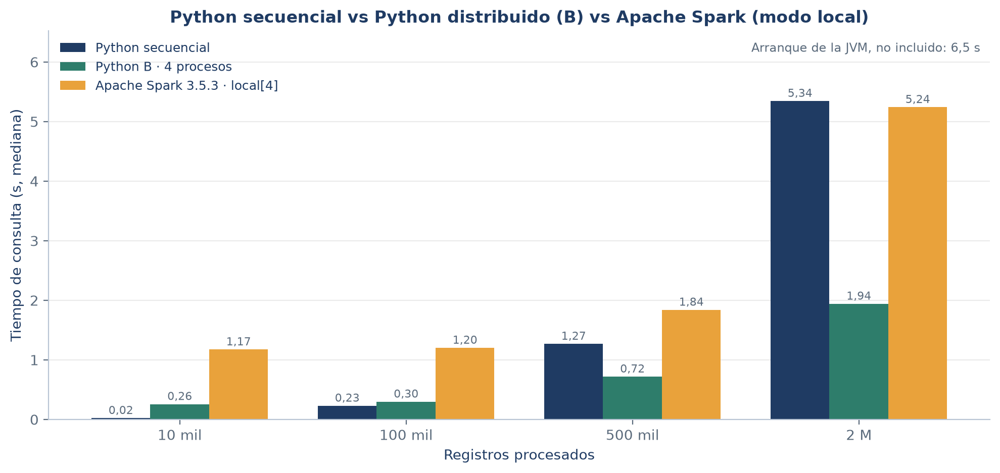

*Figura 8. Tiempo de consulta de las tres implementaciones según el volumen. Fuente: elaboración propia con datos de `resultados/spark_resultados.json`.*

---

## 9. Fase 5 — Análisis de resultados

### 9.1 ¿Qué diferencias se observaron entre los tiempos de procesamiento?

Las diferencias dependieron sobre todo de **cuántos datos había que mover**. Con la estrategia A, la versión distribuida fue más lenta que la secuencial en los tres volúmenes (de 0,04× a 0,19×). Con 500 000 registros el secuencial calculó en 0,19 s, mientras que el distribuido tardó 1,04 s, de los cuales 1,00 s (96 %) fue coordinación: en Windows cada proceso arranca un intérprete nuevo y además hay que serializar 500 000 tuplas, copiarlas a los procesos y reconstruirlas.

La estrategia B reparte el trabajo pesado —leer y convertir el texto en registros— y solo devuelve diccionarios pequeños. Con 500 000 registros bajó el tiempo de 1,03 s a 0,53 s (**1,94×**) y la coordinación se redujo a 0,14 s (27 % del total). Con 10 000 registros, ninguna estrategia compensó el costo fijo de arrancar los procesos (≈ 0,19 s), que es diez veces mayor que todo el trabajo secuencial (0,02 s).

### 9.2 ¿Cómo influyó el tamaño del conjunto de datos en el rendimiento?

El tiempo secuencial creció de forma casi lineal con los datos: de 10 000 a 500 000 registros (50 veces más) el tiempo de lectura + cálculo pasó de 0,019 s a 1,027 s (53 veces más), como se espera de un algoritmo O(n). El tiempo distribuido creció mucho menos porque tiene una parte fija: en la estrategia B pasó de 0,245 s a 0,529 s. Por eso la aceleración **mejora con el volumen**: 0,08× → 1,22× → 1,94×, y el *throughput* subió de 40 749 a 944 751 registros por segundo. El punto de equilibrio en este equipo está cerca de los 100 000 registros: por debajo conviene procesar en un solo proceso; por encima, distribuir. En otras palabras, la distribución resulta útil precisamente cuando crece el volumen de información, que es el problema planteado por la empresa.

### 9.3 ¿Qué ventajas y limitaciones presentó la distribución de tareas?

**Ventajas:**

- **Exactitud:** en todas las pruebas (3 volúmenes × 2 estrategias × 5 repeticiones, 4 configuraciones de nodos y el escenario intensivo) el resultado distribuido fue igual al secuencial.
- **Aceleración real** de hasta 2,12× con 4 nodos (estrategia B) y 2,42× en la carga intensiva.
- **Equilibrio de carga:** los bloques de bytes produjeron particiones casi idénticas (125 000 ± 39 registros) y tiempos por nodo parecidos (0,36–0,38 s).
- **Aislamiento de fallos:** cada partición puede reprocesarse por separado sin repetir todo el trabajo (Sección 9.4).

**Limitaciones:**

- **Costo de coordinación:** arrancar procesos y mover datos tiene un costo fijo que hace inútil distribuir volúmenes pequeños, y si se envían los registros (estrategia A) ese costo supera cualquier ganancia.
- **Rendimientos decrecientes:** pasar de 1 a 2 nodos redujo el tiempo un 37 %, de 2 a 4 un 25 % y de 4 a 8 solo un 0,5 %. El equipo tiene 6 núcleos físicos; con 8 procesos, los nodos compiten por los mismos núcleos, por la memoria y por el disco.
- **Ley de Amdahl:** en la estrategia B con 4 nodos, la parte no paralelizable (coordinación, 0,14 s) equivale al 14 % del tiempo secuencial, así que `p ≈ 0,86` y `S_max(4) = 1 / (0,14 + 0,86/4) ≈ 2,8×`. La aceleración observada (1,94×–2,12×) queda por debajo de ese límite por la contención de memoria y disco y por el *turbo* del procesador, que baja la frecuencia cuando trabajan varios núcleos a la vez. En el escenario intensivo, `p = (2,8972 − 0,2830) / 2,8972 ≈ 0,90` y `S_max(4) ≈ 3,1×`, frente a 2,42× observado.
- **Alcance de la simulación:** en un clúster real se sumaría la latencia de red y, a cambio, cada nodo tendría su propia CPU, memoria y disco, sin la competencia que limitó la escalabilidad aquí.

### 9.4 ¿Qué sucedería si uno de los procesos fallara antes de entregar sus resultados?

En lugar de responder solo en teoría, se programó `tolerancia_fallos.py`, que provoca fallos reales en el nodo 3 de 4 (100 000 registros) y mide cuatro escenarios:

| Escenario | Qué ocurre | Registros consolidados | Error en ingresos | Reintentos | Tiempo (s) | Resultado |
|---|---|---:|---:|---:|---:|:---:|
| Normal | Ningún nodo falla | 100 000 | 0,00 % | 0 | 0,309 | Correcto |
| Sin tolerancia a fallos | El nodo 3 lanza una excepción; se consolida lo recibido | 75 016 | **24,80 %** | 0 | 0,246 | **Incorrecto** |
| Caída + reintento | Se detecta la excepción y se reejecuta solo la partición 3 | 100 000 | 0,00 % | 1 | 0,281 | Correcto |
| Bloqueo + timeout | El nodo 3 deja de responder; se detecta por tiempo límite (3 s) y se reasigna | 100 000 | 0,00 % | 1 | 3,089 | Correcto |

**Hallazgos:**

1. **Sin tolerancia, el error es silencioso.** Se perdieron 24 984 registros y los ingresos quedaron 24,8 % por debajo del valor real, pero el top 5 de productos fue el mismo (Mouse, Audífonos, Teclado, DiscoDuro, Smartphone): un analista vería un reporte creíble y tomaría decisiones con datos incompletos. Por eso la verificación final (registros consolidados = registros esperados) es indispensable.
2. **Reintentar solo la partición fallida es barato.** Las otras tres particiones ya estaban guardadas en *checkpoints* (`resultados/checkpoints/nodo_*.json`); solo se reprocesó un cuarto de los datos. La tarea es **idempotente**: repetirla produce el mismo resultado, así que no hay duplicados.
3. **Un nodo bloqueado es más costoso que uno caído.** Una excepción se detecta de inmediato, pero un nodo que no responde solo se descubre cuando vence el tiempo límite. Aquí el escenario tardó 3,09 s, casi todo de espera. Un tiempo límite corto acelera la recuperación pero puede declarar caído a un nodo que solo estaba lento; uno largo hace lo contrario. Los sistemas reales usan *heartbeats* (señales periódicas de vida) y ejecución especulativa de las tareas más lentas.

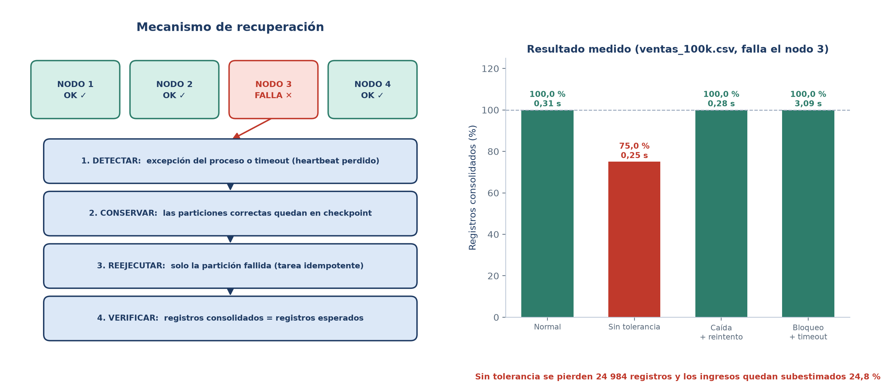

*Figura 5. Mecanismo de recuperación implementado y resultado medido en los cuatro escenarios. Fuente: elaboración propia con datos de `resultados/tolerancia_fallos.json`.*

### 9.5 ¿Qué mejoras se podrían implementar para procesar millones de registros?

1. **Usar un motor distribuido real** (Apache Spark sobre un clúster administrado con YARN o Kubernetes), que ya resuelve el particionamiento, la reasignación de tareas y la recuperación por linaje. La prueba de la Sección 8.5 muestra que el código de Spark da los mismos resultados y que, aun en un solo equipo, a partir de unos 2 millones de registros ya iguala al procesamiento secuencial; su ventaja real aparece al repartirlo entre varias máquinas.
2. **Guardar los datos en un sistema de archivos distribuido** (HDFS o almacenamiento de objetos como S3) para que cada nodo lea bloques locales, que es la estrategia B a escala de clúster.
3. **Cambiar CSV por un formato columnar comprimido** (Parquet) particionado por fecha: las consultas leen solo las columnas y meses necesarios.
4. **Mantener un pool de nodos persistente** para no pagar el arranque de procesos en cada consulta; en este equipo ese costo fue de unos 0,19 s.
5. **Combinar parciales en cada nodo antes de enviarlos** (*combiners*), como ya se hace aquí, para que por la red viajen resúmenes y no registros.
6. **Monitorizar** el tiempo por partición, los reintentos y los nodos caídos, con alertas cuando el total consolidado no coincide con el esperado.
7. **Procesamiento incremental o en flujo** (*streaming*): agregar las ventas a medida que llegan, en lugar de reprocesar todo el histórico cada vez.

### 9.6 Matriz de riesgos y mitigaciones

| Riesgo | Impacto | Mitigación | Evidencia en el laboratorio |
|---|---|---|---|
| Caída de un nodo | Se pierde un cuarto de los datos sin aviso | Detección por excepción y reintento idempotente | Escenarios 1 y 2 de `tolerancia_fallos.py` |
| Nodo bloqueado | El trabajo queda esperando indefinidamente | Tiempo límite y reasignación a otro proceso | Escenario 3 |
| Pérdida de parciales ya calculados | Hay que repetir todo el trabajo | *Checkpoints* por partición | `resultados/checkpoints/` |
| Mover demasiados datos | La distribución resulta más lenta | Localidad de datos (estrategia B) | 0,19× (A) frente a 1,94× (B) |
| Particiones desequilibradas | Un nodo retrasa a todos | Bloques de igual tamaño alineados a línea | 125 000 ± 39 registros por nodo |
| Resultado incorrecto | Decisiones de negocio erróneas | Verificación contra el secuencial y conteo de registros | Función `verificar()` |
| Datos personales | Riesgo ético y legal | Datos sintéticos | Semilla 42, sin personas reales |

---

## 10. Fase 6 — Conclusiones

1. **Distribuir no garantiza ganar velocidad; lo decisivo es cuántos datos se mueven.** Con la misma tarea, los mismos datos y los mismos 4 nodos, enviar los registros a los procesos fue 5 veces más lento que el secuencial (0,19×), mientras que dejar que cada nodo leyera su propio bloque fue casi 2 veces más rápido (1,94×). Este resultado ilustra el principio de localidad de datos sobre el que se construyen Hadoop y Spark.

2. **El procesamiento distribuido conserva la exactitud cuando las operaciones son agregables.** Como los ingresos y las unidades se combinan por suma, los resultados de las particiones pudieron integrarse en cualquier orden: la suma de los parciales coincidió con el consolidado y con el secuencial en todas las pruebas (por ejemplo, COP 1 032 194 440 715,25 en los tres casos con 500 000 registros).

3. **La escalabilidad es real pero limitada.** La aceleración mejoró con el volumen (0,08× → 1,22× → 1,94×) porque el costo fijo de coordinación se reparte entre más registros; en cambio, añadir nodos tuvo rendimientos decrecientes (1,59× con 2, 2,12× con 4 y 2,13× con 8), por la ley de Amdahl y por la competencia por los 6 núcleos físicos. El número de nodos debe elegirse a partir de mediciones y de los recursos reales disponibles.

4. **La tolerancia a fallos debe diseñarse explícitamente.** La caída de un solo nodo subestimó los ingresos un 24,8 % sin producir ningún error visible, porque el reporte seguía pareciendo razonable. Detectar el fallo, conservar los parciales correctos, reejecutar solo la partición perdida y verificar el conteo final permitió recuperar el resultado exacto con un costo mínimo; el bloqueo de un nodo, en cambio, impuso esperar al tiempo límite.

---

## 11. Procedimientos y metodología

La actividad se desarrolló con aprendizaje basado en proyectos, siguiendo un enfoque incremental:

| Etapa | Actividades realizadas | Producto |
|---|---|---|
| 1. Análisis | Lectura del caso, definición de requerimientos y métricas | Sección 4 |
| 2. Diseño | Arquitectura, elección de Python + multiprocessing y de las dos estrategias | Figura 1 |
| 3. Implementación | Generador de datos, nodos, consolidación, verificación, fallos, Spark | Código fuente |
| 4. Experimentación | 3 volúmenes, 1–8 nodos, 5 repeticiones, escenario intensivo, 4 escenarios de fallo | Carpeta `resultados/` |
| 5. Evaluación | Aceleración, eficiencia, Amdahl, exactitud y recuperación | Secciones 8 y 9 |
| 6. Documentación | Informe, figuras, evidencias e interfaz gráfica | Este documento |

**Distribución de responsabilidades sugerida** *(ajustar con los nombres del equipo)*:

| Rol | Responsabilidades | Integrante |
|---|---|---|
| Datos | Fase 1, calidad y descripción del conjunto de datos | *[Completar]* |
| Arquitectura | Fase 2, diagrama y elección de estrategias | *[Completar]* |
| Implementación | Fase 3, código de nodos, consolidación y fallos | *[Completar]* |
| Pruebas | Fase 4, ejecución de mediciones y tablas | *[Completar]* |
| Documentación | Fases 5 y 6, análisis, conclusiones y referencias | *[Completar]* |

Todos los integrantes deben poder explicar el funcionamiento de la solución. El trabajo se desarrolla en una carpeta compartida de Google Drive o Microsoft OneDrive: *[pegar aquí el enlace]*.

---

## 12. Criterios de entrega — verificación

| Entregable requerido por la guía | Dónde se encuentra |
|---|---|
| Documento técnico con introducción, objetivos, marco conceptual y descripción del problema | Secciones 1 a 4 |
| Diagrama de arquitectura del procesamiento distribuido | Sección 6, Figura 1 y Anexo B |
| Código fuente comentado | `generar_datos.py`, `procesamiento_distribuido.py`, `tolerancia_fallos.py`, `experimento_intensivo.py`, `procesamiento_spark.py`, `interfaz_grafica.py` |
| Conjunto de datos utilizado | `datos/ventas_10k.csv`, `ventas_100k.csv`, `ventas_500k.csv` |
| Evidencias de ejecución | Anexos C y D, carpetas `resultados/` y `evidencias/` |
| Tabla comparativa de tiempos | Sección 8.2 y `resultados/tabla_tiempos.csv` |
| Análisis de resultados y conclusiones | Secciones 9 y 10 |
| Referencias en formato APA 7.ª edición | Sección 13 |
| Trabajo colaborativo en Drive u OneDrive | Sección 11 *(enlace por completar)* |

---

## 13. Referencias

Apache Software Foundation. (2024a). *Apache Hadoop documentation*. https://hadoop.apache.org/docs/stable/

Apache Software Foundation. (2024b). *Spark SQL, DataFrames and Datasets guide*. https://spark.apache.org/docs/latest/sql-programming-guide.html

Amdahl, G. M. (1967). Validity of the single processor approach to achieving large scale computing capabilities. En *Proceedings of the April 18-20, 1967, Spring Joint Computer Conference* (pp. 483–485). ACM. https://doi.org/10.1145/1465482.1465560

Dean, J., & Ghemawat, S. (2008). MapReduce: Simplified data processing on large clusters. *Communications of the ACM, 51*(1), 107–113. https://doi.org/10.1145/1327452.1327492

Ghemawat, S., Gobioff, H., & Leung, S.-T. (2003). The Google file system. En *Proceedings of the 19th ACM Symposium on Operating Systems Principles* (pp. 29–43). ACM. https://doi.org/10.1145/945445.945450

Kleppmann, M. (2017). *Designing data-intensive applications: The big ideas behind reliable, scalable, and maintainable systems*. O'Reilly Media.

Python Software Foundation. (2024). *multiprocessing — Process-based parallelism*. En *Python 3.12 documentation*. https://docs.python.org/3.12/library/multiprocessing.html

Tanenbaum, A. S., & van Steen, M. (2017). *Distributed systems* (3.ª ed.). distributed-systems.net.

White, T. (2015). *Hadoop: The definitive guide* (4.ª ed.). O'Reilly Media.

Zaharia, M., Xin, R. S., Wendell, P., Das, T., Armbrust, M., Dave, A., Meng, X., Rosen, J., Venkataraman, S., Franklin, M. J., Ghodsi, A., Gonzalez, J., Shenker, S., & Stoica, I. (2016). Apache Spark: A unified engine for big data processing. *Communications of the ACM, 59*(11), 56–65. https://doi.org/10.1145/2934664

---

## Anexo A — Cómo reproducir el experimento

Requisitos: Python 3.12 o superior; `matplotlib` y `python-docx` para las figuras y el informe; `pyspark` y Java (8, 11 o 17) solo para la versión en Spark.

```powershell
cd Guia8_ProcesamientoDistribuido
python generar_datos.py              # Fase 1: datos (semilla 42)
python procesamiento_distribuido.py  # Fases 3-4: estrategias A y B, escalabilidad
python experimento_intensivo.py      # Carga CPU-intensiva
python tolerancia_fallos.py          # Fase 5: fallos y recuperación
python generar_datos.py --grande     # Opcional: 2 millones de registros
python procesamiento_spark.py        # Apache Spark (requiere pyspark y Java)
python generar_diagramas.py          # Figuras
python generar_documento.py          # Este informe en Word
```

Los parámetros se pueden cambiar con variables de entorno, por ejemplo:

```powershell
$env:LAB_NODOS = "8"; $env:LAB_REPETICIONES = "7"; python procesamiento_distribuido.py
$env:LAB_FALLO_NODO = "1"; $env:LAB_DATASET = "500k"; python tolerancia_fallos.py
```

O todo desde la interfaz gráfica: doble clic en `ABRIR_INTERFAZ.bat`.

**Estructura del proyecto:**

```
Guia8_ProcesamientoDistribuido/
├── interfaz_grafica.py · ABRIR_INTERFAZ.bat
├── generar_datos.py
├── procesamiento_distribuido.py
├── tolerancia_fallos.py
├── experimento_intensivo.py
├── procesamiento_spark.py
├── generar_diagramas.py · generar_documento.py · exportar_pdf.py
├── Informe_Laboratorio_Guia8.md / .docx / .pdf
├── datos/          ventas_10k.csv · ventas_100k.csv · ventas_500k.csv
├── diagramas/      01 a 08 (PNG)
├── evidencias/     capturas de la interfaz gráfica
└── resultados/     tablas CSV, JSON y checkpoints
```

**Uso de inteligencia artificial:** se utilizó un asistente de IA como apoyo para estructurar el código y revisar la redacción. Todas las cifras de este informe provienen de ejecuciones reales registradas en la carpeta `resultados/`; cada integrante debe ejecutar el laboratorio, revisar los resultados y poder explicarlos con sus propias palabras.

---

## Anexo B — Diagrama Mermaid editable

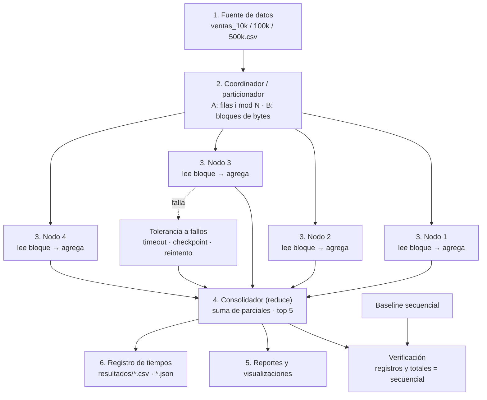

---

## Anexo C — Evidencia de ejecución en consola

Fragmento de la salida de la ejecución registrada en este informe (Windows 11, Python 3.12.10; se omiten los identificadores de proceso):

```text
>>> python procesamiento_distribuido.py
=== Pruebas de rendimiento (4 nodos, mediana de 5 repeticiones) ===
 10,000 reg. | A: T_sec= 0.008s T_dist= 0.192s S= 0.04x | B: T_sec= 0.019s T_dist= 0.245s S= 0.08x | idénticos=True
100,000 reg. | A: T_sec= 0.047s T_dist= 0.298s S= 0.16x | B: T_sec= 0.285s T_dist= 0.234s S= 1.22x | idénticos=True
500,000 reg. | A: T_sec= 0.193s T_dist= 1.039s S= 0.19x | B: T_sec= 1.027s T_dist= 0.529s S= 1.94x | idénticos=True

=== Escalabilidad: 1, 2, 4, 8 nodos (ventas_500k.csv) ===
1 nodo(s) | A: T= 1.319s S= 0.17x | B: T= 1.054s S= 0.98x E=0.98
2 nodo(s) | A: T= 1.158s S= 0.19x | B: T= 0.664s S= 1.56x E=0.78
4 nodo(s) | A: T= 1.047s S= 0.21x | B: T= 0.497s S= 2.09x E=0.52
8 nodo(s) | A: T= 1.045s S= 0.21x | B: T= 0.494s S= 2.10x E=0.26

>>> python tolerancia_fallos.py
=== Tolerancia a fallos: ventas_100k.csv, 4 nodos, falla el nodo 3 ===
[Normal (sin fallos)     ] T= 0.309s | registros 100,000/100,000 | error ingresos   0.00% | reintentos 0 | CORRECTO
[Sin tolerancia a fallos ] T= 0.246s | registros  75,016/100,000 | error ingresos  24.80% | reintentos 0 | INCORRECTO (número de registros)
    · Nodo 3: fallo simulado (proceso caído)
[Caída + reintento       ] T= 0.281s | registros 100,000/100,000 | error ingresos   0.00% | reintentos 1 | CORRECTO
    · Nodo 3: fallo simulado (proceso caído)
    · Nodo 3: partición recuperada en el intento 2
[Bloqueo + timeout       ] T= 3.089s | registros 100,000/100,000 | error ingresos   0.00% | reintentos 1 | CORRECTO
    · Nodo 3: sin respuesta tras 3.0 s (timeout)
    · Nodo 3: partición recuperada en el intento 2

>>> python experimento_intensivo.py
"tiempo_secuencial_s": 2.8972, "tiempo_distribuido_s": 1.1994,
"aceleracion": 2.416, "eficiencia": 0.604, "resultados_iguales": true

>>> python procesamiento_spark.py
=== Apache Spark 3.5.3 en modo local[4] ===
Arranque de la sesión Spark (JVM): 6.50 s
   10,000 reg. | Python secuencial= 0.021s | Python B (4 nodos)= 0.256s | Spark= 1.173s | S= 0.02x | idénticos=True
  100,000 reg. | Python secuencial= 0.228s | Python B (4 nodos)= 0.296s | Spark= 1.201s | S= 0.19x | idénticos=True
  500,000 reg. | Python secuencial= 1.267s | Python B (4 nodos)= 0.717s | Spark= 1.839s | S= 0.69x | idénticos=True
2,000,000 reg. | Python secuencial= 5.344s | Python B (4 nodos)= 1.940s | Spark= 5.240s | S= 1.02x | idénticos=True
```

---

## Anexo D — Interfaz gráfica

Para facilitar la ejecución y la presentación del laboratorio se construyó una interfaz gráfica (`interfaz_grafica.py`, solo con la biblioteca estándar `tkinter`). Desde ella se configuran los nodos, el volumen de datos y las repeticiones; se ejecuta cada paso del pipeline o todo el laboratorio (F5); y se consultan los resultados, los datos, las figuras y la consola.

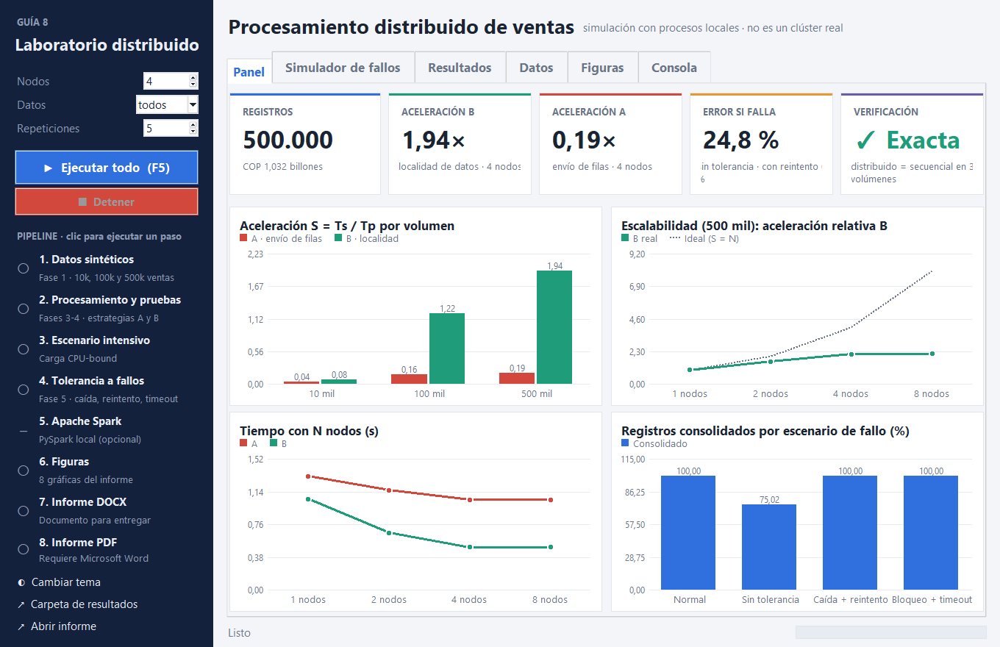

*Figura 9. Panel principal: indicadores y gráficas interactivas generadas a partir de los resultados. Fuente: elaboración propia.*

La pestaña **Simulador de fallos** ejecuta `tolerancia_fallos.py` y anima el estado de cada nodo en tiempo real a partir de los eventos que emite el script:


*Figura 10. Simulador de fallos durante la ejecución: los cuatro nodos procesan sus bloques. Fuente: elaboración propia.*


*Figura 11. Resultado del escenario "Caída + reintento" con 500 000 registros: el nodo 3 cae, se recupera y la verificación es correcta. Fuente: elaboración propia.*

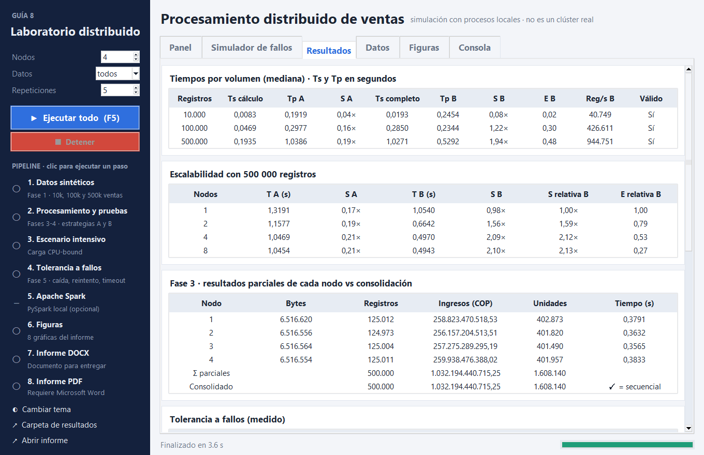

*Figura 12. Pestaña de resultados: tiempos de ambas estrategias, escalabilidad y parciales por nodo. Fuente: elaboración propia.*
